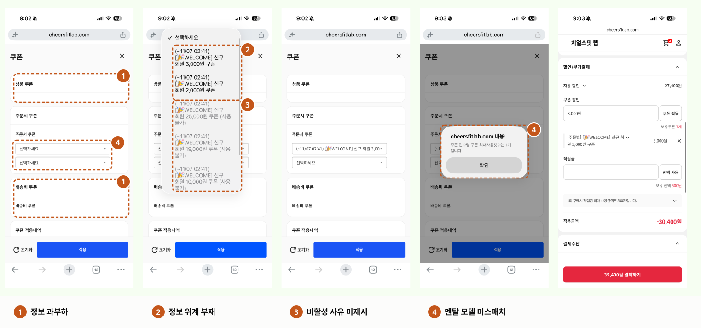

# 주문서 개선 — 포트폴리오 슬라이드 (배경 · 문제 정의 및 원인 분석 · 가설 및 기대효과 · 실행 · 검증 · 회고)

> 기준: 2026.09.07~09.27(21일), Amplitude(appId 847753), Unique Users, Conversion Window 1일
> 퍼널 수치 출처: 노션 「주문서 개선」 / 1인당 결제 금액: 카페24 주문 데이터(nerdboard) − 간편 결제
> 시나리오 근거: 외부 벤치마크(Qubit 메타분석, Analytics-Toolkit 메타분석, Baymard)만 인용, 모두 원문 확인. 다른 집계 기간의 내부 수치는 사용하지 않음.
> ※ 주문서 진입자 대부분이 신규 고객이라(9월 자사몰 주문의 79.2%가 신규 고객 첫 주문) 신규·기존을 구분하지 않고 전체 기준으로 집계함.

---

## Slide. 배경 — 자사몰 매출의 핵심 경로인 '일반 결제 주문서' 개선에 집중했습니다

_광고 타깃팅·소재 적합도 등 마케팅 외부 변수가 큰 상품 상세나 플랫폼 제약을 받는 간편 결제와 달리, 일반 결제 주문서는 매출 53.6%가 지나고 이탈률(38.7%)이 간편 결제(2.2%)의 18배에 달하면서도, 자사몰에서 직접 개선할 수 있는 최우선 영역이었습니다._

**목표** 자사몰 매출 상승 · **접근** 신규 고객 구매 전환 트랙 (기존 고객은 재구매 트랙으로 별도 진행)

**구간별 우선순위 비교**

| 구간 | 이탈률 | 매출 영향 | 통제 가능성 | 판단 |
|---|---|---|---|---|
| 상품 상세 | 95.7% | 전체 유입의 첫 관문 | 낮음 — 광고 타깃팅·소재 적합도 등 마케팅 외부 변수 | 후순위 |
| 간편 결제 (네이버페이·카카오 체크아웃) | 2.2% | 매출 46.4% | 낮음 — 플랫폼 결제 화면이라 수정 제약 | 개선 여지 작음 |
| **일반 결제 주문서** | **38.7%** (간편 결제의 18배) | **매출 53.6%** | **높음 — 자사몰 화면 직접 수정 가능** | **최우선** |

집계: 2026.09.07~09.27(21일), Amplitude Unique Users, Conversion Window 1일 · 매출 비중: 카페24 주문(nerdboard) 기준 · 주문서 진입 고객 대부분이 신규 고객(9월 자사몰 주문의 79.2%가 신규 고객 첫 주문)

---

## Slide. 문제 정의 및 원인 분석 — 퍼널과 세션 리플레이로 주문서 이탈의 핵심 원인 두 가지를 선정했습니다

_이탈이 집중된 결제 버튼 클릭 전(81명)에는 쿠폰 탐색 마찰이, 클릭 후(27명)에는 입력 오류 피드백 부재가 주 원인이었습니다._

**주문서 퍼널**

**개선 전 쿠폰 선택 흐름** (번호 = 아래 ① 관찰 항목)

| | ① 결제 버튼 클릭 전 이탈 (81명) | ② 결제 버튼 클릭 후 이탈 (27명) |
|---|---|---|
| **관찰** | **58명(71.6%)이 쿠폰 선택 화면 경유 후 이탈** · **정보 과부하 (Information Overload)**: 자사몰은 주문서 쿠폰만 운용하나 상품·배송비 쿠폰 영역도 함께 노출 · **정보 위계 부재 (Lack of Visual Hierarchy)**: 기간·쿠폰명·할인액이 드롭다운 한 줄에 같은 무게로 섞여, 핵심 정보인 할인액이 한눈에 보이지 않음 · **비활성 사유 미제시 (Unexplained Disabled State)**: 사용 불가 쿠폰이 조건 없이 '(사용 불가)'로만 표시돼, 어떤 조건이면 쓸 수 있는지 알 수 없음 · **멘탈 모델 미스매치 (Mental Model Mismatch)**: 조건을 충족한 보유 쿠폰 수만큼 선택 필드가 생성돼 함께 적용할 수 있어 보이지만, 실제로는 주문당 1장만 적용 가능 → 두 번째 필드를 선택하면 '주문 건당 최대 1개' alert로 사후 차단 | **인라인 밸리데이션 부재 (No Inline Validation)**: 필수값 누락을 필드가 아닌 전역 alert로만 알림 · **에러 가시성 부족 (Low Error Visibility)**: 고객이 누락 필드를 스크롤로 직접 찾아야 함 · **에러 복구 루프 (Error Recovery Loop)**: 수정 후 재시도해도 다음 누락 항목에서 다시 차단되는 반복 → **1인당 결제 버튼 클릭 평균 1.8회** |

**문제 정의** 구매 의사를 갖고 주문서에 들어온 고객이 ① 쿠폰 선택 과정의 혼란, ② 입력 오류 안내 부족 때문에 결제를 포기하고 있다.

집계: 2026.09.07~09.27(21일), Amplitude, 주문서 페이지 진입 → 주문 완료 페이지 진입, 테스트 계정 제외, Unique Users, Conversion Window 1일 · ① 나머지 이탈 패턴: 아무것도 누르지 않음 13명(16.0%), 배송지·결제수단 일부 입력 후 5명(6.2%), 기타 5명(6.2%)

---

## Slide. 가설 및 기대효과 — 쿠폰 탐색·입력 마찰 해소를 핵심 가설로 세우고, 일반 결제 매출 상승 목표를 수립했습니다

_쿠폰 선택 구조를 단순화하고 입력 오류를 즉시 안내하면, 업계 벤치마크 기준 주문서 전환율이 61.3%에서 최대 71.0%까지 올라 자사몰 전체 매출이 최대 8.5% 늘어날 것으로 산출했습니다._

**가설**

| 원인 | 가설 |
|---|---|
| ① 쿠폰 탐색 마찰 | **H1.** 쿠폰 선택 과정의 인지 부하를 줄여 최대 혜택을 빠르게 확신하게 하면, 결제 버튼 클릭률이 오를 것이다 |
| ② 입력 오류 피드백 부재 | **H2.** 입력 오류를 즉시·정확하게 안내하면, 결제 버튼 재시도와 클릭 후 이탈이 줄 것이다 |

**검증 지표**

| 구분 | 지표 | 현재값 | 연결 가설 |
|---|---|---|---|
| **주 지표** | 주문서 진입 → 구매 전환율 | **61.3%** | H1 · H2 |
| 보조 지표 | 주문서 진입 대비 결제 버튼 클릭률 | 71.0% | H1 |
| 보조 지표 | 1인당 결제 버튼 클릭 수 | 1.8회 | H2 |
| 보조 지표 | 결제 버튼 클릭 후 이탈률 | 13.6% | H2 |
| 보조 지표 | 주문서 진입 → 구매까지 걸린 시간 (중앙값) | 개선 전 측정값 | H1 · H2 |
| 가드레일 | 1인당 결제 금액 | 41,711원 | 최대 할인 자동 적용으로 객단가가 떨어지지 않는지 점검 |

1인당 결제 버튼 클릭 수 = `click.orderForm.paymentButton` 총 클릭 수 ÷ 클릭 사용자 수(테스트 계정 제외) · 구매까지 걸린 시간은 개선 전후 모두 같은 전환 기준(1일)으로 측정 · 1인당 결제 금액은 카페24 주문 기준(일반 결제, 9/7~9/27)

**자사몰 매출 기여도** 일반 결제 전환율 상승 시 자사몰 전체 매출 **+1.6~8.5%**

| 시나리오 | 상대 상승률 | 근거 (원문 수치) | 주문서 전환율 | 자사몰 매출 기여도 | 참고: 21일 환산 |
|---|---|---|---|---|---|
| 보수 | +2.9% | 이커머스 UX 개선 실험 6,700건 중 최고 효과 유형의 평균¹ | 61.3% → 63.1% | +1.6% | 약 21만 원 |
| **기본** | **+7.5%** | 효과가 확인된 UX 개선의 상승률 중앙값² | → **65.9%** | **+4.0%** | 약 53만 원 |
| 낙관 | +15.9% | 효과가 확인된 UX 개선의 상승률 평균² | → 71.0% | +8.5% | 약 113만 원 |

자사몰 매출 기여도 = 일반 결제 매출 비중 53.6% × 상대 상승률 (주문서 진입 수·1인당 결제 금액·간편 결제 매출이 그대로라는 가정, 유입 규모와 무관) · 21일 환산 = 9/7~9/27 결제 완료 171명 × 상대 상승률 × 1인당 41,711원(카페24 주문 기준), 같은 유입 가정의 참고값 · 업계 상한 참고: 체크아웃 UX 전반 개선 시 전환율 최대 +35%³ (이번은 쿠폰·배송지 부분 개선) · 시나리오는 유사 UX 개선의 효과 크기를 참고한 추정치이며, 실제 성과는 개선 전후 비교로 측정해 유입·시즌 등 외부 요인이 함께 반영될 수 있음

출처 ¹ Browne & Jones (2017), What works in e-commerce – a meta-analysis of 6,700 online experiments, Qubit: 대형 이커머스 실험 6,700건을 유형별로 분석한 메타분석. 희소성 문구(재고 알림)가 방문자당 매출 평균 +2.9%(95% CI 2.3~3.6%, 125건)로 가장 효과가 컸고, 전체 실험의 90%는 매출 변화 ±1.2% 이내 · ² Georgiev (2022), What Can Be Learned From 1,001 A/B Tests?, Analytics-Toolkit: 결과와 무관하게 수집한 온라인 실험 1,001건 메타분석. 전체 상승률은 중앙값 0.08%·평균 2.08%, 통계적으로 유의하게 효과가 확인된 실험은 중앙값 7.5%·평균 15.9% · ³ Baymard Institute, Cart & Checkout Usability Research: 대형 이커머스 체크아웃 사용성 연구. 평균 32개 개선 항목을 반영하면 전환율 최대 +35% 개선 잠재력

---

## Slide. 실행 — 두 가설을 검증하기 위해 쿠폰 선택과 배송지 입력 화면을 재설계했습니다

_[서브: 핵심 개선 N가지 + 적용 시점. 예) 최대 할인 자동 적용·단일 선택 쿠폰 UI·필드 단위 에러 안내를 [MM/DD]에 적용했습니다.]_

| 가설 | 개선 전 (As-Is) | 개선 후 (To-Be) | 설계 원리 |
|---|---|---|---|
| H1 | 쓰지 않는 쿠폰 영역 노출, 보유 쿠폰 수만큼 선택 필드, 사용 조건 미표시 | 최대 할인 쿠폰 자동 적용(기본값), 단일 선택 UI, 할인액·조건·남은 기간 위계 정리 | 기본값 효과 · 선택 피로 감소 |
| H1 | 결제 버튼에 최종 가격만 표시 | 결제 버튼에 시작 금액 → 최종 금액 흐름 표시 | 이득 프레이밍 |
| H2 | 필수값 누락 시 전역 alert만 노출 | 누락 필드 하이라이트·자동 포커싱·필드 단위 에러 메시지 | 에러 예방·복구 |

[개선 전/후 화면 캡처 배치 · 적용일 · 적용 범위(회원/비회원, 모바일/PC)]

---

## Slide. 검증 — 개선 전후 같은 기준으로 주 지표·보조 지표·가드레일을 비교했습니다

_[서브: 헤드라인 확정 후 작성. 예) 주문서 전환율이 60.4%에서 67.5%로 11.7% 올라 기본 시나리오를 넘었고, 1인당 결제 금액도 7.0% 올랐습니다.]_

| 구분 | 지표 | 개선 전 (9/7~9/27) | 개선 후 (10/29~11/18) | 변화 |
|---|---|---|---|---|
| **주 지표** | 주문서 진입 → 구매 전환율 | 60.4% (171 ÷ 283) | **67.5% (160 ÷ 237)** | **+11.7%** |
| 보조 (H1) | 주문서 진입 대비 결제 버튼 클릭률 | 70.3% (199 ÷ 283) | 74.3% (176 ÷ 237) | +4.0%p |
| 보조 (H2) | 1인당 결제 버튼 클릭 수 | 1.8회 (356 ÷ 199) | 1.4회 (245 ÷ 176) | −22.2% |
| 보조 (H2) | 결제 버튼 클릭 후 이탈률 | 14.1% (28 ÷ 199) | 9.1% (16 ÷ 176) | −5.0%p |
| 보조 | 주문서 진입 → 주문 완료까지 걸린 시간 (중앙값) | 142초 | 109초 | −23.2% |
| 가드레일 | 1인당 결제 금액 | 41,711원 | 44,612원 | +7.0% |

**자사몰 매출 기여도** (기대효과와 같은 식)

| | 보수 | 기본 | 낙관 | **실측** |
|---|---|---|---|---|
| 상대 상승률 | +2.9% | +7.5% | +15.9% | **+11.7%** |
| 자사몰 매출 기여도 (53.6% × 상대 상승률) | +1.6% | +4.0% | +8.5% | **+6.3%** |

**같은 기간 실제 매출 변화** 광고비 −16.3%로 자사몰 전체 매출은 −5.5%였으나, 일반 결제 매출은 −1.9%로 간편 결제(−9.7%)보다 감소폭이 작았고 일반 결제 매출 비중은 53.6% → 55.7%로 커짐

퍼널: 주문서 페이지(/order/orderform.html) 진입 → 결제 버튼 클릭(click.orderForm.paymentButton) → 주문 완료 페이지(/order/order_result.html) 진입, Conversion Window 1일, Unique Users, 개선 전후 같은 21일 · 개선 전후 동일 비교를 위해 두 기간 모두 제외 조건 없이 재집계(9월 60.4%는 문제 정의 장의 61.3%와 집계 조건이 달라 4명 차이) · 걸린 시간은 주문서 진입 → 주문 완료 2단계 퍼널 중앙값 · 매출 기여도는 유입·객단가·간편 결제가 그대로라는 가정의 추정치 · 11/17~18 진입자는 전환 기간(1일)이 조회 시점에 끝나지 않았을 수 있음

---

## Slide. 회고 — [배운 점을 한 문장으로]

_[서브: 가장 큰 학습 한 문장]_

| | 내용 |
|---|---|
| **잘된 점** | [ ] |
| **아쉬운 점** | [ ] |
| **다음 액션** | [ ] |

---

## 부록 A. 1인당 결제 금액 집계 (21일)

| 구분 | 주문 수 | 매출 | 출처 |
|---|---|---|---|
| 카페24 전체 | 343건 | 13,223,967원 | nerdboard (카페24 주문) |
| − 간편 결제 (네이버페이·카카오 체크아웃) | 173건 | 6,133,127원 | Amplitude `Purchase.value` (서버 전송) |
| **= 일반 결제** | **170건** | **7,090,840원** | → **1인당 41,711원** |

- Amplitude의 일반 결제 `Purchase`는 주문 완료 페이지 조회자(178명) 중 일부가 누락되어 금액 기준으로 쓰지 않음
- 카페24 주문 데이터는 트래킹 누락과 무관하므로 전체에서 간편 결제를 빼서 일반 결제를 산출. 일반 결제 170건 ≈ 퍼널 결제 완료 171명
- 간편 결제 금액은 서버 전송 이벤트로 `$revenue`와 `value`가 일치해 누락 가능성 낮다고 판단(카페24 직접 대조는 미실시)
- 일반 결제 매출 비중: 7,090,840 ÷ 13,223,967 = 53.6%

## 부록 A-2. 개선 후 1인당 결제 금액 (2026.10.29~11.18, 21일, 부록 A와 같은 방식)

| 구분 | 주문 수 | 매출 | 출처 |
|---|---|---|---|
| 카페24 전체 | 286건 | 12,498,634원 | nerdboard (카페24 주문) |
| − 간편 결제 (네이버페이 124건 5,306,200원 + 카카오 체크아웃 6건 232,914원) | 130건 | 5,539,114원 | Amplitude `Purchase.value` (서버 전송) |
| **= 일반 결제** | **156건** | **6,959,520원** | → **1인당 44,612원** (9월 대비 +7.0%) |

- 일반 결제 매출 비중: 6,959,520 ÷ 12,498,634 = 55.7%
- 교차 확인: Amplitude orderform `Purchase` 151건·6,785,220원 → 44,935원 (차이 0.7%)

## 부록 B. 신규 고객 비중 (nerdboard, 참고)

- 2026년 9월 카페24 신규 고객 393명 / 카페24 주문 496건 → 주문의 79.2%가 신규 고객 첫 주문
- 월 단위·자사몰 전체(간편 결제 포함) 기준이라 21일 주문서 진입자 기준 정확한 값은 카페24 주문 엑셀로 확정 필요

## 출처 URL
1. https://gwern.net/doc/economics/advertising/2017-browne.pdf (Qubit 원문 PDF 사본)
2. https://blog.analytics-toolkit.com/2022/what-can-be-learned-from-1001-a-b-tests/
3. https://baymard.com/research/checkout-usability
