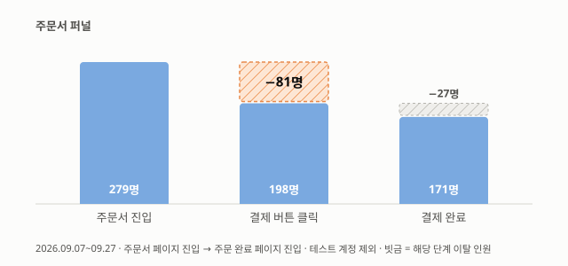

# 주문서 개선 — 포트폴리오 슬라이드 (배경 · 문제 정의 및 원인 분석 · 가설 및 기대효과)

> 기준: 2026.09.07~09.27(21일), Amplitude(appId 847753), Unique Users, Conversion Window 1일
> 퍼널 수치 출처: 노션 「주문서 개선」 / 1인당 결제 금액: 카페24 주문 데이터(nerdboard) − 간편 결제
> 시나리오 근거: 외부 벤치마크(DRIP, VWO, Baymard)만 인용. 다른 집계 기간의 내부 수치는 사용하지 않음.
> ※ 주문서 진입자 대부분이 신규 고객이라(9월 자사몰 주문의 약 79%가 신규 고객 첫 주문) 신규·기존을 구분하지 않고 전체 기준으로 집계함.

---

## Slide. 배경 — 자사몰 매출의 핵심 경로인 '일반 결제 주문서' 개선에 집중했습니다

_광고 타깃팅·소재 적합도 등 마케팅 외부 변수가 큰 상품 상세나 플랫폼 제약을 받는 간편 결제와 달리, 일반 결제 주문서는 매출 54%가 지나고 이탈률(38.7%)이 간편 결제(2.16%)의 18배에 달하면서도, 자사몰에서 직접 개선할 수 있는 최우선 영역이었습니다._

**목표** 자사몰 매출 상승 · **접근** 신규 고객 구매 전환 트랙 (기존 고객은 재구매 트랙으로 별도 진행)

**구간별 우선순위 비교**

| 구간 | 이탈률 | 매출 영향 | 통제 가능성 | 판단 |
|---|---|---|---|---|
| 상품 상세 | 95.7% | 전체 유입의 첫 관문 | 낮음 — 광고 타깃팅·소재 적합도 등 마케팅 외부 변수 | 후순위 |
| 간편 결제 (네이버페이·카카오 체크아웃) | 2.16% | 매출 46% | 낮음 — 플랫폼 결제 화면이라 수정 제약 | 개선 여지 작음 |
| **일반 결제 주문서** | **38.7%** (간편 결제의 18배) | **매출 54%** | **높음 — 자사몰 화면 직접 수정 가능** | **최우선** |

집계: 2026.09.07~09.27(21일), Amplitude Unique Users, Conversion Window 1일 · 매출 비중: 카페24 주문(nerdboard) 기준 · 주문서 진입 고객 대부분이 신규 고객(9월 자사몰 주문의 약 79%가 신규 고객 첫 주문)

---

## Slide. 문제 정의 및 원인 분석 — 퍼널과 세션 리플레이로 주문서 이탈의 핵심 원인 두 가지를 선정했습니다

_이탈이 집중된 결제 버튼 클릭 전(81명)에는 쿠폰 탐색 마찰이, 클릭 후(27명)에는 입력 오류 피드백 부재가 주 원인이었습니다._

**주문서 퍼널**

**개선 전 쿠폰 선택 흐름** (번호 = 아래 ① 관찰 항목)

| | ① 결제 버튼 클릭 전 이탈 (81명) | ② 결제 버튼 클릭 후 이탈 (27명) |
|---|---|---|
| **관찰** | **58명(71.6%)이 쿠폰 선택 화면 경유 후 이탈** · **정보 과부하 (Information Overload)**: 자사몰은 주문서 쿠폰만 운용하나 상품·배송비 쿠폰 영역도 함께 노출 · **정보 위계 부재 (Lack of Visual Hierarchy)**: 기간·쿠폰명·할인액이 드롭다운 한 줄에 같은 무게로 섞여, 핵심 정보인 할인액이 한눈에 보이지 않음 · **비활성 사유 미제시 (Unexplained Disabled State)**: 사용 불가 쿠폰이 조건 없이 '(사용 불가)'로만 표시돼, 어떤 조건이면 쓸 수 있는지 알 수 없음 · **멘탈 모델 미스매치 (Mental Model Mismatch)**: 조건을 충족한 보유 쿠폰 수만큼 선택 필드가 생성돼 함께 적용할 수 있어 보이지만, 실제로는 주문당 1장만 적용 가능 → 두 번째 필드를 선택하면 '주문 건당 최대 1개' alert로 사후 차단 | **인라인 밸리데이션 부재 (No Inline Validation)**: 필수값 누락을 필드가 아닌 전역 alert로만 알림 · **에러 가시성 부족 (Low Error Visibility)**: 고객이 누락 필드를 스크롤로 직접 찾아야 함 · **에러 복구 루프 (Error Recovery Loop)**: 수정 후 재시도해도 다음 누락 항목에서 다시 차단되는 반복 → **결제 버튼 재시도 평균 2.4회/인** |

**문제 정의** 구매 의사를 갖고 주문서에 들어온 고객이 ① 쿠폰 선택 과정의 혼란, ② 입력 오류 안내 부족 때문에 결제를 포기하고 있다.

집계: 2026.09.07~09.27(21일), Amplitude, 주문서 페이지 진입 → 주문 완료 페이지 진입, 테스트 계정 제외, Unique Users, Conversion Window 1일 · ① 나머지 이탈 패턴: 아무것도 누르지 않음 13명(16.0%), 배송지·결제수단 일부 입력 후 5명(6.2%), 기타 5명(6.2%)

---

## Slide. 가설 및 기대효과 — 쿠폰 탐색과 입력 마찰을 제거해 일반 결제 매출을 최대 15%까지 끌어올리고자 했습니다

_불필요한 쿠폰 탐색과 평균 2.4회의 결제 버튼 반복 클릭을 해소하면, 업계 성공 벤치마크(+10~15%) 기준 주문서 전환율을 61.3%에서 최대 70.5%까지 개선할 수 있을 것으로 산출했습니다._

**가설**

| 원인 | 가설 (If → Then) | 설계 원리 | 검증 지표 |
|---|---|---|---|
| ① 쿠폰 탐색 마찰 | **H1. 쿠폰 사용성 개선** — 쓰지 않는 쿠폰 영역을 없애고, 단일 선택 UI와 할인액 중심 위계로 정리해 최대 혜택을 기본값으로 제시하면 → 탐색 시간이 줄어 결제 버튼 클릭률이 오른다 | 기본값 효과 · 선택 피로 감소 · 어포던스 | 쿠폰 화면 경유자의 결제 버튼 클릭률 |
| ① 쿠폰 탐색 마찰 | **H2. 할인 가격 실시간 확인** — 쿠폰 적용 즉시 할인액과 최종 결제 금액을 갱신하고, 결제 버튼에 시작가 → 최종가 흐름을 보여 주면 → 가격 확신이 빨라져 구매 보류가 줄어든다 | 이득 프레이밍 · 가격 앵커 일치 | 주문서 진입 대비 결제 버튼 클릭률 |
| ② 입력 오류 피드백 부재 | **H3. 배송지 사용성 개선** — 배송지 입력을 별도 화면으로 분리하고, 누락 필드를 하이라이트·자동 포커싱해 필드 단위 에러 메시지로 한 번에 안내하면 → 재시도가 줄어 클릭 후 이탈률이 낮아진다 | 에러 예방 · 에러 복구 지원 | 1인당 결제 버튼 클릭 수(현재 2.4회), 클릭 후 이탈률(현재 13.6%) |

**기대 매출** 주문서 전환율 상승 시 21일 추가 매출 **+21만~143만 원**

| 시나리오 | 상대 상승률 | 근거 | 주문서 전환율 | 추가 구매 | 추가 매출 (21일) |
|---|---|---|---|---|---|
| 보수 | +3% | A/B 테스트 상승률 중앙값¹ | 61.3% → 63.1% | +5명 | 약 21만 원 |
| **기본** | **+10~15%** | 성공 테스트의 일반적 상승폭 10~20%² | → **67.4~70.5%** | +17~26명 | **약 71~107만 원** |
| 낙관 | +20% | 성공 테스트 상승폭 상단² | → 73.6% | +34명 | 약 143만 원 |

추가 매출 = 결제 완료 171명 × 상대 상승률 × 일반 결제 1인당 결제 금액 41,711원(카페24 주문 기준) · 낙관 시나리오도 이탈 108명 중 34명 회복 수준 · 체크아웃 전면 개편 사례(최대 +35%³)는 부분 개선인 이번 건에 미적용 · 간편 결제 수준은 고객 성향 차이로 목표에서 제외

출처 ¹ DRIP, Statistical Power in A/B Testing ² Evinent, Ecommerce A/B Testing (VWO 2025 State of Optimization 인용) ³ Baymard Institute, Cart & Checkout Usability Research

---

## 부록 A. 1인당 결제 금액 집계 (21일)

| 구분 | 주문 수 | 매출 | 출처 |
|---|---|---|---|
| 카페24 전체 | 343건 | 13,223,967원 | nerdboard (카페24 주문) |
| − 간편 결제 (네이버페이·카카오 체크아웃) | 173건 | 6,133,127원 | Amplitude `Purchase.value` (서버 전송) |
| **= 일반 결제** | **170건** | **7,090,840원** | → **1인당 41,711원** |

- Amplitude의 일반 결제 `Purchase`는 주문 완료 페이지 조회자(178명) 중 일부가 누락되어 금액 기준으로 쓰지 않음
- 카페24 주문 데이터는 트래킹 누락과 무관하므로 전체에서 간편 결제를 빼서 일반 결제를 산출. 일반 결제 170건 ≈ 퍼널 결제 완료 171명
- 간편 결제 금액은 서버 전송 이벤트로 `$revenue`와 `value`가 일치해 누락 가능성 낮다고 판단(카페24 직접 대조는 미실시)
- 일반 결제 매출 비중: 7,090,840 ÷ 13,223,967 = 약 54%

## 부록 B. 신규 고객 비중 (nerdboard, 참고)

- 2026년 9월 카페24 신규 고객 393명 / 카페24 주문 496건 → 주문의 약 79%가 신규 고객 첫 주문
- 월 단위·자사몰 전체(간편 결제 포함) 기준이라 21일 주문서 진입자 기준 정확한 값은 카페24 주문 엑셀로 확정 필요

## 출처 URL
1. https://dripagency.de/blog/statistical-power-ab-testing
2. https://evinent.com/blog/what-is-ecommerce-ab-testing
3. https://baymard.com/research/checkout-usability
